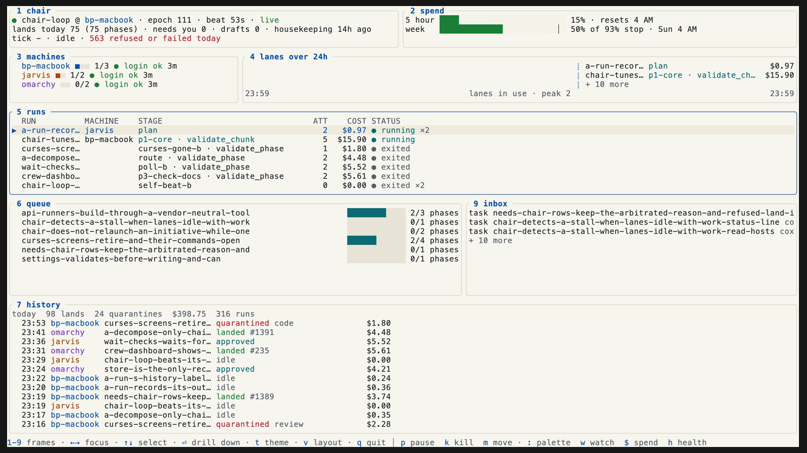

<p align="center">
  <picture>
    <source media="(prefers-color-scheme: dark)" srcset="docs/assets/shell-banner-dark.svg">
    
  </picture>
</p>

# coxswain

<p align="center"><em>Agents pull the oars. You hold the tiller.</em></p>

<p align="center">
  <a href="https://ppfenning.github.io/coxswain/latest/">Docs</a> ·
  <a href="https://ppfenning.github.io/coxswain/latest/releases/">Releases</a> ·
  <a href="https://pypi.org/project/coxswain/">PyPI</a>
</p>

---

Coxswain is a platform that builds software with a crew of AI agents and keeps a person on the tiller. You describe a change; it is filed as a work item, planned, built in a worktree under a dollar budget, reviewed by two independent reviewers who are made to disagree, arbitrated, checked against the project's own tests as evidence, and handed to you as a pull request. You merge. Every step leaves a record you can read back.

**Status: beta.** The loop runs itself daily on its own repository. Interfaces are still moving; see the [release notes](https://ppfenning.github.io/coxswain/latest/releases/) for what each version changes.

<p align="center">
  <picture>
    <source media="(prefers-color-scheme: dark)" srcset="docs/assets/towpath/regatta-dark.png">
    
  </picture>
</p>

<p align="center"><em>towpath, Coxswain's terminal home: the chair, the machines and every run on one screen.</em></p>

## Install

One package, `coxswain`. One command, `cox`.

```sh
brew install ppfenning/coxswain/cox        # or: uv tool install --python 3.14 coxswain
git clone --branch <tag> https://github.com/ppfenning/coxswain ~/.local/share/coxswain/installs/coxswain
cox install --team my-team
mkdir -p <workspace>/work <workspace>/runs <workspace>/intake <workspace>/cartridges
git -C <workspace> init
cartridge init my-team --cartridges-dir <workspace>/cartridges
cox setup doctor
```

`<tag>` is a release tag, such as `v2026.10.0`. That one checkout is the whole install: `cox install` reads its `manifest.toml`, creates one venv inside it, installs `cox` editable from it, writes this machine's profile and links the crew. `<workspace>` is `~/.local/share/coxswain/workspaces/main` unless you pass `--workspace`. The profile starts on the shipped provider profile; a team keeps its own outside the checkout, in `<home>/providers/` or the workspace (see the [install guide](https://ppfenning.github.io/coxswain/latest/install/#the-provider-profile)). The install's closing doctor may report the missing workspace and cartridge until the `mkdir`, `git init` and `cartridge init` steps are done.

`cox setup doctor` tells you whether this machine can run an epic and what is missing. The [install guide](https://ppfenning.github.io/coxswain/latest/install/) covers a fresh machine end to end.

## Upgrade

```sh
brew upgrade cox            # or: uv tool upgrade coxswain
cox upgrade
```

The first updates `cox` itself. `cox upgrade` moves the checkout to the newest release, syncs its venv, reinstalls `cox` from it and relinks the crew.

**Coming from 0.47 or earlier?** Those releases installed a checkout per component. On each machine:

```sh
cox host drain <host>                                  # if the host is active in the hosts table
brew upgrade cox                                       # Homebrew; with uv, the next two lines instead
uv tool uninstall coxswain-tools agent-cartridges
uv tool install --python 3.14 'coxswain[postgres,traces,parquet,lake]'   # the extras this machine uses
cox setup migrate                                      # the plan; changes nothing
cox setup migrate --apply
cox setup doctor
cox host activate <host>
```

Move a team provider profile out of the old cartridges checkout to `<home>/providers/` first, and edit by hand any of your own scripts that name an old checkout path. Old checkouts are moved to `installs/.retired-<date>/`, never deleted. [From 0.47 to the monorepo](https://ppfenning.github.io/coxswain/latest/monorepo/) has every step and the known issues in 2026.10.0.

## The loop, in one screen

```
cox route file  --repo R --title T --body FILE   # a work item, from a sentence or a file
cox route launch epic --initiative work/<id>     # plan → build → review ×2 → arbitrate → check → validate
cox runs top                                     # every run in flight, live
cox runs land <run> --repo R --apply             # rebase, PR, merge on green, clean up
```

A run is a detached process. It plans one task at a time, builds it in a worktree it owns, runs the real tests, and asks two reviewers — one holding the change to the team's written charter, one whose job is to find what is wrong — before an arbiter decides. A task that fails its budget is split, never given more money. Nothing merges to a default branch without a person.

## Layout

| Folder | What it holds |
|---|---|
| [`src/tools`](src/tools) | The `cox` command: install, doctor, route, runs, land, the setup screens. |
| [`src/graphs`](src/graphs) | What runs: the graphs as pure functions, and the harness that budgets, reviews, checks and records them. |
| [`src/cartridges`](src/cartridges) | Who a run works for: roles, skills, budgets, policy, provider profiles, the plugin marketplace. |
| [`crew`](crew) | The seats: who speaks, with what authority, in what voice. |
| `docs/`, `devtools/`, `tests/` | The docs site, the release tooling, and the root suite. |

The dashboard, `towpath`, is a separate Rust repository, [coxswain-dash](https://github.com/ppfenning/coxswain-dash); `cox install --with dash` adds it, and the Homebrew formula includes it.

Each folder runs its own suite: `cd src/tools && uv run pytest -q`, and the same in `src/graphs` and `src/cartridges`. The root suite is `uv run pytest -q` from the repository root.

## Versions

Releases are CalVer, `YYYY.M.N`, tagged `vYYYY.M.N`: the year, the month, and a count of releases in that month from 0. The first is 2026.10.0. A release is one tag, one PyPI publish, one GitHub release and one Homebrew formula update. The number does not promise compatibility; the store and workspace schema and `cox setup migrate` carry that. 0.47.0 was the last release of the old multi-repository line.

## Make it yours

Everything a stranger needs is a command in a public repository; everything that makes it yours is a file the command reads. A **cartridge** is that file for your team — which skills each role carries, what budget a build gets, what a reviewer holds code to. A **profile** is that file for your machine. Neither is code. `cartridge init <team>` writes one that inherits everything and lets you tighten what you care about; the [customize guide](https://ppfenning.github.io/coxswain/latest/customize/) walks through it.

## Contributing

Every change lands as a pull request, most of them built by the platform itself. Ruff runs in CI and pre-commit with one shared rule set; `pre-commit install` mirrors it locally. Ideas go in as intake items and are decomposed before they are built.

## License

MIT. See [LICENSE](LICENSE).
