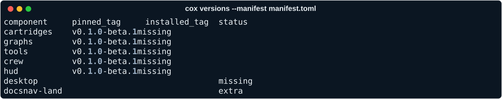
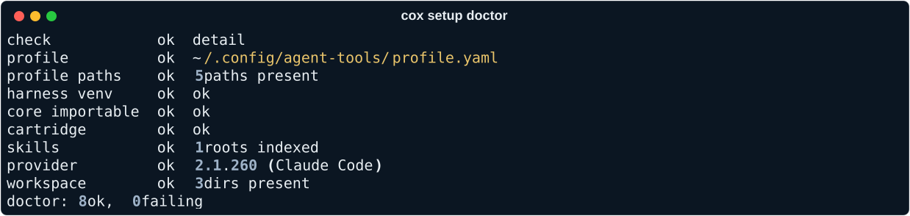

# Install

Coxswain is one package, `coxswain`, and one command, `cox`. Install `cox`,
then let `cox install` set up the rest.

```sh
brew install ppfenning/coxswain/cox          # or: uv tool install --python 3.14 coxswain
cox install --team my-team
mkdir -p <workspace>/work <workspace>/runs <workspace>/intake <workspace>/cartridges
git -C <workspace> init
cartridge init my-team --cartridges-dir <workspace>/cartridges
cox setup doctor
```

`<home>` is the coxswain home: `--home`, else `COXSWAIN_HOME`, else
`$XDG_DATA_HOME/coxswain`, else `~/.local/share/coxswain`. `<workspace>` is
`<home>/workspaces/main` unless you pass `--workspace`.

When the home has no checkout, `cox install` clones one at the release tag
matching its own version into `<home>/installs/coxswain`, then reads
`manifest.toml` from it. That checkout is the whole install: there is one,
with one venv.

The doctor that `cox install` runs at its close may report the missing
workspace and cartridge until the `mkdir`, `git init` and `cartridge init`
steps are done.

## Getting `cox`

**Homebrew** (macOS, and Linux with Homebrew):

```sh
brew install ppfenning/coxswain/cox
```

Current Homebrew refuses a formula from a third-party tap until you trust the
tap. If it does, run `brew trust ppfenning/coxswain` once and install again.
The formula also installs `towpath`, the dashboard.

The formula carries no optional extras. After `brew install` and after every
`brew upgrade cox`, run `cox setup extras`. It installs `traces`, `parquet`,
`lake` and `postgres` into the venv `cox` runs from, at the versions this
release's `uv.lock` pins, and pip checks the sha256 of every wheel. Without
it `cox setup doctor` reports that the store needs psycopg. `--with EXTRA ...`
picks a subset and `--dry-run` prints what would be installed. When the
extras are already present at the locked versions it says so and changes
nothing.

**uv**:

```sh
uv tool install --python 3.14 coxswain
```

`uv` must already be on your `PATH`; get it from <https://docs.astral.sh/uv/>.
The `--python 3.14` flag makes uv fetch a 3.14 interpreter when none is
present. Add the extras the machine uses, for example
`uv tool install --python 3.14 'coxswain[postgres,traces,lake]'`. A shared
Postgres store needs `postgres`. The extras are `traces`, `postgres`,
`parquet`, `lake`, `analytics` and `live`; `cox install` keeps the ones the
tool already has. If your shell cannot find `cox` afterwards, run
`uv tool update-shell` and open a new shell.

## What `cox install` does

1. Reads `manifest.toml` in the checkout of
   [ppfenning/coxswain](https://github.com/ppfenning/coxswain) at
   `<home>/installs/coxswain`. It refuses a checkout with uncommitted
   changes, and refuses a `--provider` that the manifest does not mark
   `supported`. A clean checkout is installed as it is; moving it to another
   release is `cox upgrade`'s job.
2. Creates one venv in that checkout, `<checkout>/.venv`, with `uv sync`.
3. Installs `cox` editable from the checkout, so `cox` and the harness run
   the same code.
4. Writes the profile for this machine, `~/.config/agent-tools/profile.yaml`,
   when it has none: `harness_dir` is `<checkout>/src/graphs`,
   `skills_roots` is `<checkout>/src/cartridges/skills-plugins`, and
   `provider_profile` is the shipped default,
   `<checkout>/src/cartridges/providers/claude-code.yaml`. See
   [The provider profile](#the-provider-profile) for pointing it at your
   team's own.
5. Links the crew seats from `<checkout>/crew` into `~/.claude/agents`.
6. Fetches dash when you pass `--with dash`. Dash is the only optional
   component; it lives in its own repository.
7. Runs `cox setup doctor`. It also checks that the `--provider` CLI
   (`claude` by default) is on `PATH`.

## Channels

| Channel | The checkout follows | Command |
| --- | --- | --- |
| release | the release tag `vYYYY.M.N` | `cox install` |
| edge | `main` | `cox install --edge` |

To keep a machine on the newest commit of `main` that passed CI, use the
[edge upgrade channel](#the-edge-upgrade-channel) instead.

## Flags

Run `cox install --help` for the flags your version accepts. The ones this
page uses:

| Flag | Meaning |
| --- | --- |
| `--team` | Which team's cartridge the profile names. |
| `--workspace` | The workspace the crew works in; `<home>/workspaces/main` by default. Required with `--root`. |
| `--home` | Absolute path of the coxswain home, used when `--root` is omitted. |
| `--root` | Use the checkout at `<root>/coxswain` instead of `<home>/installs/coxswain`. |
| `--provider` | Which provider in `manifest.toml` to install for; `claude-code` by default, and only a `supported` one is accepted (see [Providers](providers.md)). |
| `--with dash` | Also install dash (`towpath`). |
| `--edge` | Follow `main` instead of the release tag. |
| `--dry-run` | Print the plan and change nothing. |

## Store the Claude token

This step is required. Sign in with `claude` first. Then store a long-lived
token that coxswain uses for its own `claude` processes.

1. Run `claude setup-token`.
2. Run `cox setup token`. It takes the token by prompt, by `--token`, or from
   an existing file with `--from-file`. It stores the token with mode 600 in
   `~/.config/agent-tools/`.

Lanes and the chair must never stop at an expired interactive login. A stored
token does not expire that way. Lane auth also must not depend on shell
startup files. That broke once: a shell function wrapper made the login check
pass while every lane failed.

The token is inference-only, so do not export it in your interactive shells.
Coxswain injects it only into the `claude` processes it spawns. A normal
`claude auth login` session in your own shell keeps Remote Control.

Check the result with `cox setup token status --probe` and `cox setup doctor`.

## Verify

```sh
cox setup doctor
```

`cox setup doctor` checks the checkout, its venv, the profile and the home,
and that the configured provider's CLI is on `PATH`.

## What you'll see



`cox versions` lists the checkout's release, and dash's tag when dash is
installed, against `manifest.toml`.



`cox setup doctor` against a real install.

## The provider profile

A provider profile is team configuration: which CLI drives the seats, the
model, effort and budget for each tier and role, the tools each role may
call, and the shared store and trace locations (`storage_url`,
`traces_url`, `lake_url`, `object_store`). The checkout ships default profiles in
`<checkout>/src/cartridges/providers/`, and `cox install` points this
machine at `claude-code.yaml` there. That is enough for one person trying
Coxswain.

A team keeps its own profile outside the code checkout, so `cox upgrade`
never touches it and the checkout stays clean. Put it in one of two places:

- `<home>/providers/<team>.yaml`, one copy per machine;
- the workspace, for example `<workspace>/providers/<team>.yaml`, so it
  travels with the workspace's git history.

Start from the shipped one, and copy `catalog.yaml` beside it (prices are
read from the `catalog.yaml` next to the profile):

```sh
mkdir -p <home>/providers
cp <home>/installs/coxswain/src/cartridges/providers/claude-code.yaml <home>/providers/my-team.yaml
cp <home>/installs/coxswain/src/cartridges/providers/catalog.yaml <home>/providers/
```

Then set `provider_profile` in `~/.config/agent-tools/profile.yaml` to
that path, or pass `--provider-profile PATH` to `cox setup install`. The
doctor's `home paths` row fails when `provider_profile` sits outside both
`<home>` and the workspace.

Personal setup never goes in the code checkout. It lives in three places:

- **The team cartridge**, in `<workspace>/cartridges/<team>`, holds the
  cast, the policy, the inline repos and the context packs.
- **The provider profile** holds the tiers, budgets, tools and the store.
- **The machine profile**, `~/.config/agent-tools/profile.yaml`, holds this
  machine's paths, the forge and tracker, the operator (`operator:`) and the
  notifier (`notify:`).

## Upgrade

Update `cox` itself, then the checkout:

```sh
brew upgrade cox            # or: uv tool upgrade coxswain
cox upgrade
```

`cox upgrade` moves the checkout to the newest release tag (or `--to
VERSION`), syncs its venv, reinstalls `cox` from it with the extras it had,
relinks the crew, moves dash if you have it, and runs the doctor. It refuses
a checkout with uncommitted changes. `--to` also takes a commit SHA.

### The edge upgrade channel

Each machine has an upgrade channel in its machine profile. `stable` is the
default: `cox upgrade` moves to the newest release tag, as above. `edge`
follows `main`, but only commits whose CI passed:

```sh
cox settings set profile upgrade_channel edge
cox setup unit-env               # writes ~/.config/agent-tools/garage.env with the stored token
cox upgrade --install-timer      # writes coxswain-upgrade.service and .timer
systemctl --user daemon-reload
systemctl --user enable --now coxswain-upgrade.timer
```

On macOS the same `cox upgrade --install-timer` writes a launchd agent,
`~/Library/LaunchAgents/coxswain-upgrade.plist`, that runs the same command on
the same interval, and prints the `launchctl bootstrap` line that loads it.
The agent stores no secret. At each launch it reads the env file described
below, so a new token takes effect on the next run without a reinstall. The
plist is written with mode 0600.

#### Check the schedule on a macOS host

The test suite cannot run launchd, so check a macOS host by hand after you
install or change the schedule:

```sh
plist=~/Library/LaunchAgents/coxswain-upgrade.plist
plutil -lint "$plist"                                  # prints: OK
launchctl bootstrap gui/$(id -u) "$plist"             # once; it fails if already loaded
launchctl kickstart -k gui/$(id -u)/coxswain-upgrade  # run it now, not in 30 minutes
cox versions                                          # the edge upgrade line: a fresh time and an outcome
```

The check passes when `plutil` prints `OK` and `cox versions` shows an edge
upgrade from the run you just started (the record is `edge-upgrade.json` in
the installs folder). If the machine was already at the newest green commit, no
record is written; the agent's run is then visible in `log show --predicate
'process == "launchd"' --last 5m`. If the record is unchanged, run the command from the
plist's `ProgramArguments` by hand. Its output names the step that failed.

`cox setup unit-env` writes the one environment file that the chair, lander
and upgrade units all read: systemd units load it with `EnvironmentFile=`, and
launchd agents get its values as `EnvironmentVariables`. It keeps the
`NAME=value` lines the file already has and sets `CLAUDE_CODE_OAUTH_TOKEN`
from the token that `cox setup token` stored. Run it again after you change the
token.

A shell you open yourself, by ssh or at the terminal, does not read that file.
So `cox upgrade` and `cox setup doctor` read it themselves when you run them by
hand. They read the files the installed upgrade unit names: every
`EnvironmentFile=` line, with `%h` as your home and a later file winning, or the
file the launchd agent sources. If no upgrade unit names one, they try the chair
unit, then the lander unit, then the default `~/.config/agent-tools/garage.env`.

A variable that your shell already sets keeps its value, even when it is empty.
The rest come from the file. The command prints names and paths, never values:

- the variables it loaded;
- the shell variables that override a different value in the file (if you
  rotated a key in the file, unset the old one in your shell);
- any value it did not load because a unit would read it differently, such as
  a quoted value (`K="abc"`), one with a space, `$` or `%`, or an empty one.
  Rewrite those as plain `NAME=value`;
- a file a unit names that does not exist, and a file skipped because it is
  not UTF-8 text.

`cox setup doctor --json` loads the file without printing anything.

On an edge machine, `cox upgrade` with no `--to` does these steps:

1. It finds the newest commit on `origin/main` whose `ci` workflow passed on
   the push to `main`. It never takes the tip of `main` unless the tip passed.
2. It moves the checkout to that commit by the same path as `cox upgrade --to`.
3. If the commit changed, it restarts the chair and lander user units that
   are running.
4. It runs `cox setup doctor` and checks that every unit that was running
   before is running again.
5. If the move or a restart fails, or a required doctor row fails, it moves
   back to the previous commit and restarts the units again.

The required doctor rows are the ones an upgrade can break: the profile, the
workspace, the harness venv, the core import, the install bins, the unit
PATH, the store, the store schema, and the restarted units. The other rows,
such as the token file and the plugins, are advisory. An advisory failure
prints one warning line and does not roll back.

Every `git` and `gh` call has a time limit. A call that hangs is killed, and
the upgrade stops with a line that names it, for example
`gh run timed out after 120 seconds`.

A lane host's checkout sync never moves the install checkout. The host
resolves both paths, following symlinks. If the lane's checkout is the
install, the sync leaves it alone and reports that the lane needs its own
checkout. The install moves only through `cox upgrade`.

The timer runs `cox upgrade --scheduled` every 30 minutes by default
(`--interval-minutes` changes this). On a stable machine the scheduled run does
nothing. Apart from a rollback, an edge upgrade never moves to an older
commit. It skips a commit it has already rolled back until a newer commit
passes CI. To try that commit again, run `cox upgrade --to SHA`.

`cox versions` shows the last edge upgrade: when it ran, the previous commit,
the chosen commit and the outcome.

Store migrations go forward only. The restarted chair or lander applies a new
commit's migrations when it opens the store. After that, an older commit
refuses the store. So when the new commit adds a migration and the units
restarted, a failing doctor is **not** rolled back. `cox versions` reports
`not_rolled_back`, and the fix is a newer commit or a person. Every machine
that shares a store must be on the same channel. Otherwise an edge machine
can migrate the store past what a stable machine's release can open. Setting
a machine back to `stable` moves it to the newest release on its next
`cox upgrade`, which has the same limit.

`cox install --edge` is a different thing: it installs the tip of `main`
once, whether or not CI passed.

## Moving from 0.47 or earlier

A machine installed with 0.47.0 or earlier has a checkout per component. Move
it to the one-checkout layout with `cox setup migrate`; see
[From 0.47 to the monorepo](../monorepo.md).

## Uninstall

There is no `cox uninstall` yet. Remove `cox` with `brew uninstall cox` or
`uv tool uninstall coxswain`, then delete the coxswain home (or `--root`) by
hand.

See [Supported machines](machines.md) for prerequisites on specific
platforms.
