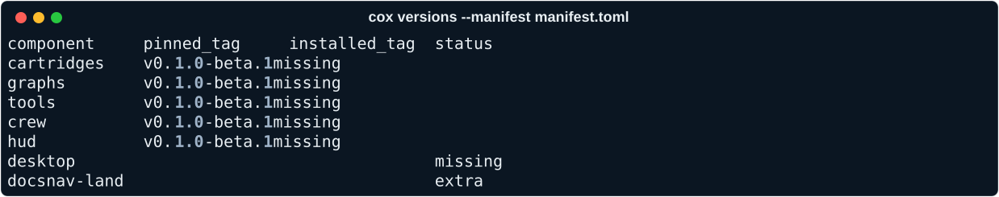
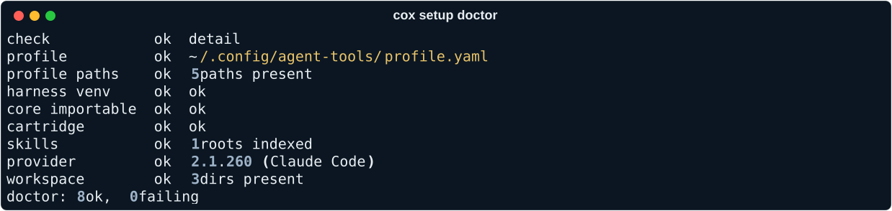

# Install

Coxswain is one package, `coxswain`, and one command, `cox`. Install `cox`,
then let `cox install` set up the rest.

```sh
brew install ppfenning/coxswain/cox          # or: uv tool install --python 3.14 coxswain
git clone --branch <tag> https://github.com/ppfenning/coxswain <home>/installs/coxswain
cox install --team my-team
mkdir -p <workspace>/work <workspace>/runs <workspace>/intake <workspace>/cartridges
git -C <workspace> init
cartridge init my-team --cartridges-dir <workspace>/cartridges
cox setup doctor
```

`<tag>` is a release tag, such as `v2026.10.0`. `<home>` is the coxswain
home: `--home`, else `COXSWAIN_HOME`, else `$XDG_DATA_HOME/coxswain`, else
`~/.local/share/coxswain`. `<workspace>` is `<home>/workspaces/main` unless
you pass `--workspace`.

`cox install` reads `manifest.toml` from the checkout at
`<home>/installs/coxswain`, which is why the repository is cloned there first.
That checkout is the whole install: there is one, with one venv.

The doctor that `cox install` runs at its close may report the missing
workspace and cartridge until the `mkdir`, `git init` and `cartridge init`
steps are done.

## Getting `cox`

**Homebrew** (macOS, and Linux with Homebrew):

```sh
brew install ppfenning/coxswain/cox
```

Current Homebrew refuses a formula from a third-party tap until you trust the
tap. If it does, run `brew trust ppfenning/coxswain` once and install again.
The formula also installs `towpath`, the dashboard.

**uv**:

```sh
uv tool install --python 3.14 coxswain
```

`uv` must already be on your `PATH`; get it from <https://docs.astral.sh/uv/>.
The `--python 3.14` flag makes uv fetch a 3.14 interpreter when none is
present. Add the extras the machine uses, for example
`uv tool install --python 3.14 'coxswain[postgres,traces,lake]'`. A shared
Postgres store needs `postgres`. The extras are `traces`, `postgres`,
`parquet`, `lake`, `analytics` and `live`; `cox install` keeps the ones the
tool already has. If your shell cannot find `cox` afterwards, run
`uv tool update-shell` and open a new shell.

## What `cox install` does

1. Reads `manifest.toml` in the checkout of
   [ppfenning/coxswain](https://github.com/ppfenning/coxswain) at
   `<home>/installs/coxswain`. It refuses a checkout with uncommitted
   changes, and refuses a `--provider` that the manifest does not mark
   `supported`. A clean checkout is installed as it is; moving it to another
   release is `cox upgrade`'s job.
2. Creates one venv in that checkout, `<checkout>/.venv`, with `uv sync`.
3. Installs `cox` editable from the checkout, so `cox` and the harness run
   the same code.
4. Writes the profile for this machine, `~/.config/agent-tools/profile.yaml`,
   when it has none: `harness_dir` is `<checkout>/src/graphs`,
   `skills_roots` is `<checkout>/src/cartridges/skills-plugins`, and
   `provider_profile` is the shipped default,
   `<checkout>/src/cartridges/providers/claude-code.yaml`. See
   [The provider profile](#the-provider-profile) for pointing it at your
   team's own.
5. Links the crew seats from `<checkout>/crew` into `~/.claude/agents`.
6. Fetches dash when you pass `--with dash`. Dash is the only optional
   component; it lives in its own repository.
7. Runs `cox setup doctor`. It also checks that the `--provider` CLI
   (`claude` by default) is on `PATH`.

## Channels

| Channel | The checkout follows | Command |
| --- | --- | --- |
| release | the release tag `vYYYY.M.N` | `cox install` |
| edge | `main` | `cox install --edge` |

## Flags

Run `cox install --help` for the flags your version accepts. The ones this
page uses:

| Flag | Meaning |
| --- | --- |
| `--team` | Which team's cartridge the profile names. |
| `--workspace` | The workspace the crew works in; `<home>/workspaces/main` by default. Required with `--root`. |
| `--home` | Absolute path of the coxswain home, used when `--root` is omitted. |
| `--root` | Use the checkout at `<root>/coxswain` instead of `<home>/installs/coxswain`. |
| `--provider` | Which provider in `manifest.toml` to install for; `claude-code` by default, and only a `supported` one is accepted (see [Providers](providers.md)). |
| `--with dash` | Also install dash (`towpath`). |
| `--edge` | Follow `main` instead of the release tag. |
| `--dry-run` | Print the plan and change nothing. |

## Verify

```sh
cox setup doctor
```

`cox setup doctor` checks the checkout, its venv, the profile and the home,
and that the configured provider's CLI is on `PATH`.

## What you'll see



`cox versions` lists the checkout's release, and dash's tag when dash is
installed, against `manifest.toml`.



`cox setup doctor` against a real install.

## The provider profile

A provider profile is team configuration: which CLI drives the seats, the
model, effort and budget for each tier and role, the tools each role may
call, and the shared store and trace locations (`storage_url`,
`traces_url`, `lake_url`, `object_store`). The checkout ships default profiles in
`<checkout>/src/cartridges/providers/`, and `cox install` points this
machine at `claude-code.yaml` there. That is enough for one person trying
Coxswain.

A team keeps its own profile outside the code checkout, so `cox upgrade`
never touches it and the checkout stays clean. Put it in one of two places:

- `<home>/providers/<team>.yaml`, one copy per machine;
- the workspace, for example `<workspace>/providers/<team>.yaml`, so it
  travels with the workspace's git history.

Start from the shipped one, and copy `catalog.yaml` beside it (prices are
read from the `catalog.yaml` next to the profile):

```sh
mkdir -p <home>/providers
cp <home>/installs/coxswain/src/cartridges/providers/claude-code.yaml <home>/providers/my-team.yaml
cp <home>/installs/coxswain/src/cartridges/providers/catalog.yaml <home>/providers/
```

Then set `provider_profile` in `~/.config/agent-tools/profile.yaml` to
that path, or pass `--provider-profile PATH` to `cox setup install`. The
doctor's `home paths` row fails when `provider_profile` sits outside both
`<home>` and the workspace.

Personal setup never goes in the code checkout. It lives in three places:

- **The team cartridge**, in `<workspace>/cartridges/<team>`, holds the
  cast, the policy, the inline repos and the context packs.
- **The provider profile** holds the tiers, budgets, tools and the store.
- **The machine profile**, `~/.config/agent-tools/profile.yaml`, holds this
  machine's paths, the forge and tracker, the operator (`operator:`) and the
  notifier (`notify:`).

## Upgrade

Update `cox` itself, then the checkout:

```sh
brew upgrade cox            # or: uv tool upgrade coxswain
cox upgrade
```

`cox upgrade` moves the checkout to the newest release tag (or `--to
VERSION`), syncs its venv, reinstalls `cox` from it with the extras it had,
relinks the crew, moves dash if you have it, and runs the doctor. It refuses
a checkout with uncommitted changes.

## Moving from 0.47 or earlier

A machine installed with 0.47.0 or earlier has a checkout per component. Move
it to the one-checkout layout with `cox setup migrate`; see
[From 0.47 to the monorepo](../monorepo.md).

## Uninstall

There is no `cox uninstall` yet. Remove `cox` with `brew uninstall cox` or
`uv tool uninstall coxswain`, then delete the coxswain home (or `--root`) by
hand.

See [Supported machines](machines.md) for prerequisites on specific
platforms.
