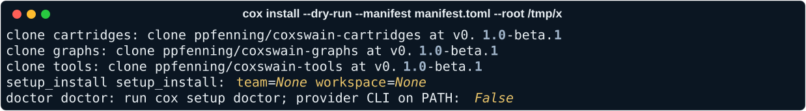

# Supported machines

Every platform below needs `git` and `curl` before you run the installer.
Coxswain needs Python 3.14 or newer; `uv` downloads a managed Python 3.14
when the system one is older, so you don't need to install it yourself.
Install `uv` itself first, or install `cox` with Homebrew.

## Arch and Omarchy

`git` and `curl` are in the official repos: `pacman -S git curl`. Omarchy
ships both by default, so on a stock Omarchy install there is nothing to do
before running the installer.

## Debian and Ubuntu

`apt install git curl` covers the prerequisites. The system `python3` is
usually older than 3.14, which is fine: `uv` downloads its own.

## macOS

`git` ships with the Xcode Command Line Tools (`xcode-select --install`).
`curl` is preinstalled. `uv` downloads Python 3.14 if the system one is
older, or install it with `brew install python@3.14`.

## Proxmox LXC

Use an unprivileged container with a current Debian or Ubuntu template, and
follow the Debian and Ubuntu prerequisites above. Nesting isn't required —
the installer doesn't need a container runtime, just the two prerequisites
and network access to GitHub.

## Docker clean room

For a disposable, fully isolated install, run the installer inside a
container built from a Debian or Ubuntu base image with `git` and `curl`
installed. This is the fastest way to try Coxswain without
touching the host machine at all.

## Lane hosts

Every lane host runs `cox setup token` itself. A remote lane reads the token
from its own host's file. The token is never sent over ssh or placed in a
command line.

The chair's login check reports a host with no token file as a named failure.
So does `cox setup doctor` when you give it a host name.

The same check, and `cox setup doctor`, also look at what the smoke gate needs
on the host:

- the docker daemon answers;
- the pinned smoke images are present, or `docker pull` can fetch them without
  a prompt (its credential helper answers in an unattended session);
- `pg_dump` and `psql` are on the PATH the lane's login shell sets;
- `gh` is a real binary, not a version-manager shim with no version set;
- the host answers over ssh;
- `/tmp` (and `$TMPDIR` when the lane sets one) has at least 2 GiB free, and
  at least 2 GiB of memory is available.

The chair places no lane on a host that fails one of these. Its status line
names the host and the failing checks, for example
`needs chair: <host>:lane_prereqs docker daemon: ...`. The check only reads,
so running the doctor again changes nothing. A host that passes every docker
check reports the `docker` capability (`lane capabilities: docker`).

## What you'll see

`cox install --dry-run` prints the plan `cox install` would run, before it writes anything.
