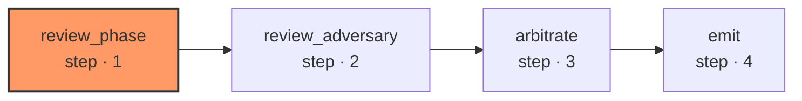

# phase-review

The phase lane (L6) builds a phase's tasks without a review each: a task is planned, built, checked and rolled up onto the phase branch, and the phase is reviewed once, after its smoke has passed at the branch's tip. This graph is that review. Its reviewer, adversary and arbiter are lifecycle-propose's own (`_review_round`), under the same tier arithmetic and arbitration trigger, lifted from one task's patch to the branch's diff against its base. The smoke's checks fill the slot a build's `commands_run` fills there, so the reviewers meet them under the sentence that says the harness ran them.

| Node | Step |
|---|---|
| `review_phase` | 1 |
| `review_adversary` | 2 |
| `arbitrate` | 3 |
| `emit` | 4 |
