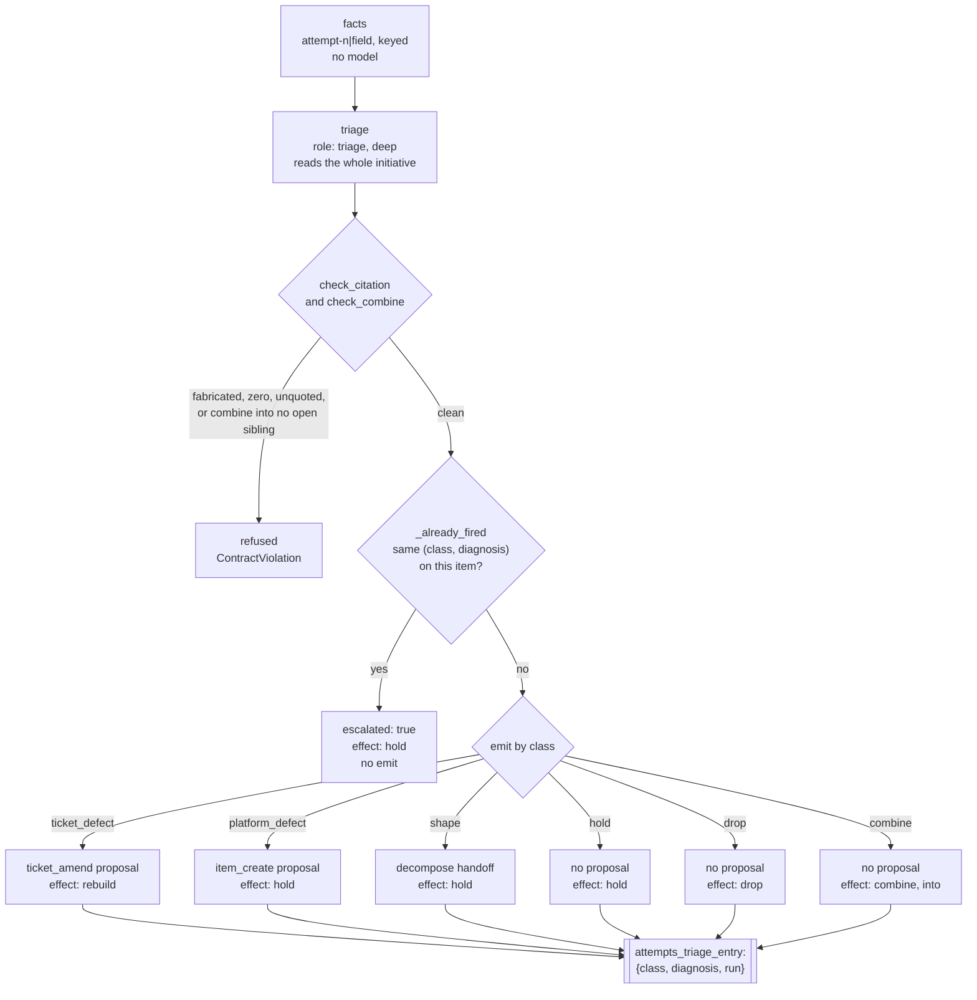

# triage-quarantine — specification

Classifies a stranded item, at the attempt cap or when the chair asks for it,
and emits by class. See
[`docs/design/triage.md`](../../docs/design/triage.md) §1 for the decided
design; this page is the graph's own shape.

| Node | Role | Tier | Notes |
|---|---|---|---|
| `facts` | — | — | pure arithmetic over the work item and its attempts; no model |
| `triage` | `triage` | deep | reads the initiative too; `{class, diagnosis, cites[], action, into?}`; a fabricated cite, zero cites, a diagnosis quoting no record text, or a `combine` into no open sibling is refused |
| `emit` | — | — | the class table below, or an escalation when the pair already fired |

**Args:** `run_id`, `date`, `cartridge` (required, no fallback), `work_item`,
`attempts`; optional `initiative_context` (the initiative's goal, its phases
with their goals, and every sibling task's id, phase, state, title and needs)
and `triaged` (the triage records the store kept for this task).

## The class table

Each answer names the `effect` the epic applies to the task.

| Class | Emits | Effect |
|---|---|---|
| `ticket_defect` | a `ticket_amend` proposal carrying the exact text to append | `rebuild`: built again on the amended body |
| `platform_defect` | an `item_create` intake proposal naming the mechanism | `hold`: the task waits for a person |
| `shape` | a `decompose` handoff — the split is decompose's job, not triage's | `hold`: the task waits for a person with the proposed split |
| `hold` | nothing | `hold`: a person decides, with the diagnosis |
| `drop` | nothing | `drop`: the initiative's goal does not need the task |
| `combine` | nothing | `combine`: the task's scope folds into the open sibling `into` names |

A model that still answers `genuine_reject` is read as `hold`.

## Never the same pair twice

`_already_fired` reads `attempts[].triage`, and the `triaged` records the
store kept, for a prior `(class, diagnosis)` match before `emit` runs. A
repeat is not more evidence — it is the same reasoning restated — so it
escalates with effect `hold` instead of clearing the cap again. This is why
`emit` never sees a class it has already used on this exact diagnosis for
this item.

**Status:** `facts`, `check_citation`, `check_combine`, `triage` and `emit`
are implemented in [`triage_quarantine.py`](triage_quarantine.py)
(docs/design/triage.md §1). The graph runs as the `triage-quarantine`
subcommand; the epic driver invokes it for a task at its attempt cap and for
a task the chair flagged for triage, and applies each effect. The
additive-diff check on a `ticket_amend` proposal (§2) lives in the epic
driver, and `cox runs stranded` (§3) lists stranded items.
